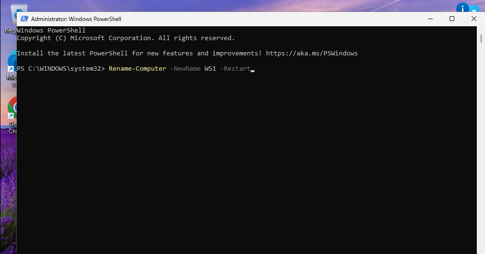
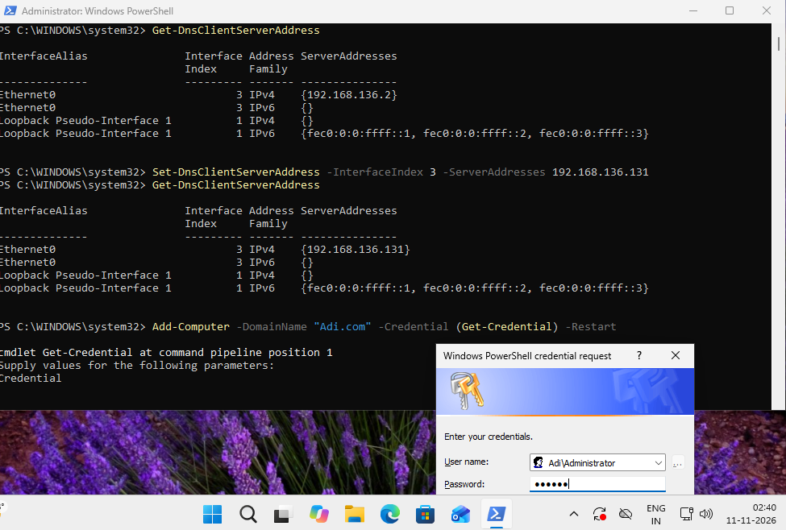
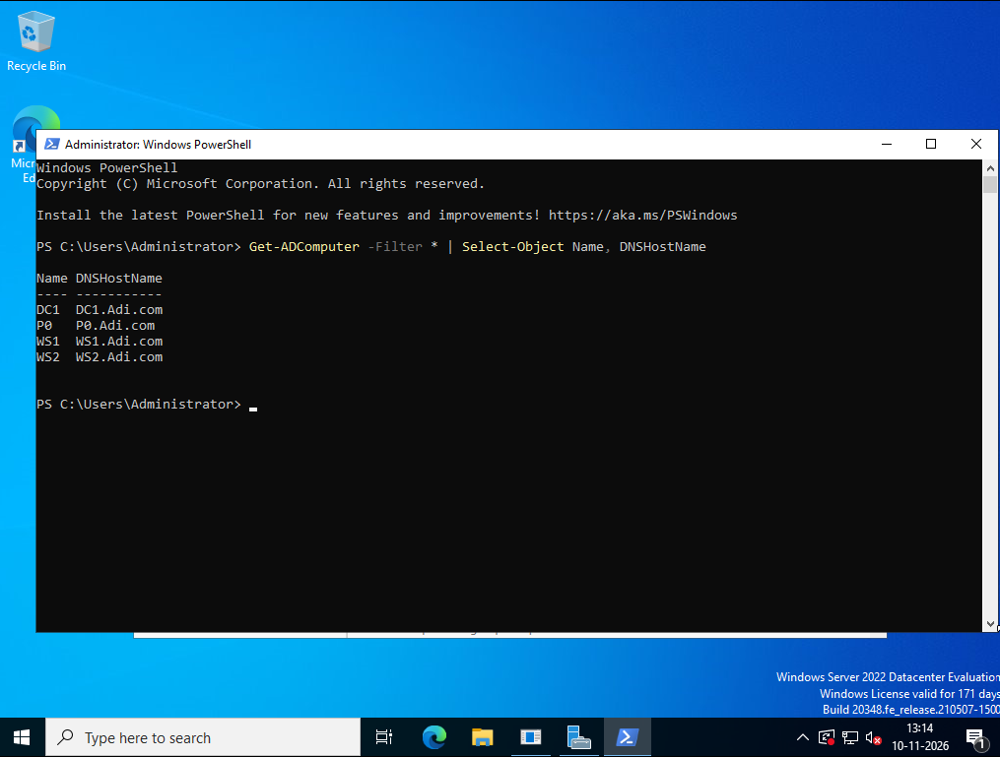
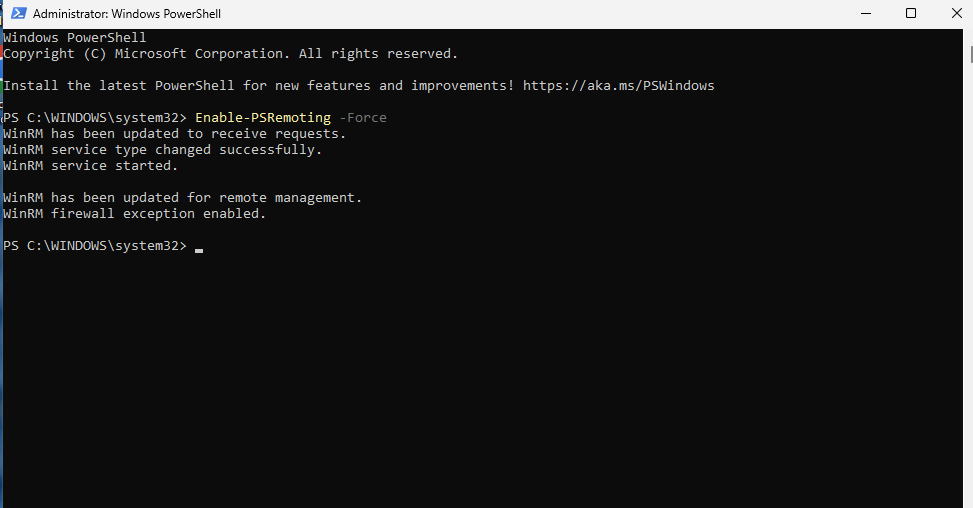
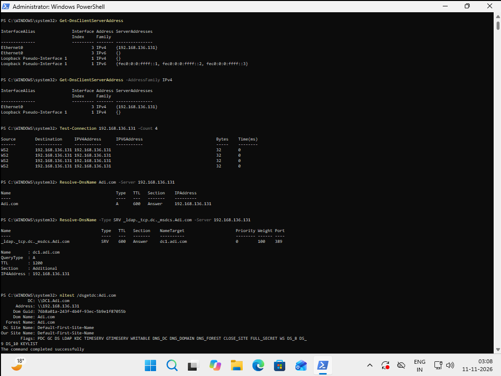
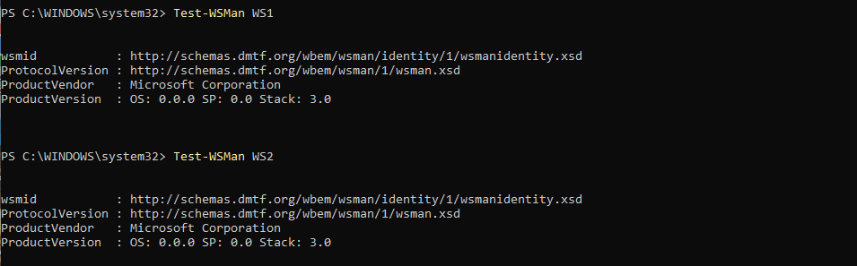

# AD Genesis
### Automated Active Directory Provisioning & Workstation Administration

> Generate identities. Provision the domain. Assign privileges. Manage endpoints.

ADGenesis is a PowerShell-based Active Directory automation project designed to generate domain users and security groups, provision them within an existing Active Directory environment, assign group memberships, and manage local Administrator access across multiple domain-joined Windows workstations.

Built around a JSON-driven workflow, ADGenesis uses a central Management Client (MC) to orchestrate operations across a Domain Controller (DC) and multiple Workstations (WS).

 <br/>

---

## Overview

ADGenesis automates two major stages of Active Directory lab management:

### 1. Configuration Generation — `randomDomain.ps1`

Generates randomized:

- Active Directory users.
- Security group names.
- User passwords.
- Group membership assignments.
- Local administrator assignments across multiple workstations.

The generated configuration is exported as a JSON file, separating data generation from actual AD provisioning.

### 2. Active Directory Provisioning — `genAD.ps1`

Consumes the generated JSON and performs the provisioning operations:

- Creates Active Directory security groups.
- Creates enabled domain user accounts.
- Assigns users to their designated AD groups.
- Adds selected domain users to local Administrators groups on specified workstations.
- Supports removal of generated users, groups, and workstation memberships through Undo mode.

All provisioning operations are initiated from the Management Client.

---

## Features

### `randomDomain.ps1` — Domain Configuration Generator

| Feature | Description |
|---|---|
| Random User Generation | Generates unique combinations of first and last names from supplied datasets. |
| Random Group Generation | Selects unique AD group names from the provided group dataset. |
| Password Assignment | Assigns a password to every generated user. |
| Group Assignment | Assigns each generated user to one randomly selected group. |
| Local Admin Selection | Randomly selects a configurable number of users for local administrator privileges. |
| Multi-Workstation Support | Assigns selected users to multiple workstation hostnames. |
| JSON Export | Exports the generated domain configuration to JSON. |
| Input Validation | Validates counts, data availability, and workstation requirements. |
| Output Directory Creation | Automatically creates the output directory when required. |

### `genAD.ps1` — Active Directory Provisioning Engine

| Feature | Description |
|---|---|
| Domain Discovery | Retrieves domain information from Active Directory. |
| DC Selection | Supports specifying a Domain Controller. |
| AD Group Creation | Creates Global Security groups. |
| AD User Creation | Creates enabled domain user accounts. |
| Username Generation | Generates usernames using the first character of the first name followed by the last name. |
| Group Membership | Adds users to their configured AD groups. |
| Local Administrator Assignment | Adds domain users to the local Administrators group on specified workstations. |
| Remote Execution | Uses PowerShell Remoting to perform workstation operations directly from MC. |
| Credential Support | Accepts optional workstation credentials. |
| Undo Mode | Removes generated users, groups, and configured local administrator memberships. |
| Managed Object Identification | Uses a description marker to identify objects created by the script. |

---

## Architecture

The Management Client acts as the central orchestration point.

```text
                  MANAGEMENT CLIENT (MC)
              ┌──────────────────────────────┐
              │                              │
              │       randomDomain.ps1       │
              │           genAD.ps1          │
              │                              │
              │         domain.json          │
              │                              │
              └──────────────┬───────────────┘
                             │
                ┌────────────┴────────────┐
                │                        │
          AD PowerShell             PowerShell
             / RSAT                  Remoting
                │                        │
                ▼                        ▼
       ┌─────────────────┐       ┌─────────────────────┐
       │ DOMAIN          │       │    WORKSTATIONS     │
       │ CONTROLLER      │       │                     │
       │                 │       │  ┌─────┐ ┌─────┐    │
       │ AD Users        │       │  │ WS1 │ │ WS2 │    │
       │ AD Groups       │       │  └─────┘ └─────┘    │
       │ Memberships     │       │        ┌─────┐      │
       │                 │       │        │ WS3 │      │
       └─────────────────┘       │        └─────┘      │
                                 └─────────────────────┘
```

### Machine Responsibilities

| Machine | Role | Responsibilities |
|---|---|---|
| MC | Management Client | Runs both scripts, stores JSON, initiates AD and workstation operations. |
| DC | Domain Controller | Hosts Active Directory, users, groups, and directory services. |
| WS1 | Workstation 1 | Domain-joined endpoint. |
| WS2 | Workstation 2 | Domain-joined endpoint. |
| WS3 | Workstation 3 | Domain-joined endpoint. |

### Communication Flow

ADGenesis uses two independent communication paths:

**MC → DC**

- Active Directory PowerShell module.
- RSAT.
- AD user and group operations.
- Domain discovery and validation.

**MC → WS**

- PowerShell Remoting.
- Local Administrators group management.
- Remote execution on individual workstations.

The workstation operations are initiated directly from MC rather than being relayed through DC. This avoids relying on the MC → DC → WS second-hop credential delegation path.

---

## Project Structure

```text
ADGenesis/
│
├── README.md
├── .gitignore
├── LICENSE
│
├── randomDomain.ps1
├── genAD.ps1
│
└── data/
    ├── group_names.txt
    ├── first_names.txt
    ├── last_names.txt
    └── passwords.txt
```

---

## Requirements

### Infrastructure

- Windows Server 2022 Domain Controller.
- Windows 11 Management Client.
- One or more Windows 11 workstations.
- VMware Workstation or another virtualization platform.
- Existing Active Directory domain: `Adi.com`.
- NetBIOS domain name: `Adi`.

### Management Client

- Windows PowerShell.
- Active Directory PowerShell module (RSAT).
- Network connectivity to the Domain Controller.
- Network connectivity to all target workstations.
- An account authorized to create and remove AD users and groups.
- An account authorized to manage local Administrators membership on target workstations.

### Domain Controller

- AD DS configured and operational.
- DNS functioning.
- Domain reachable from MC and all workstations.

### Workstations

- Joined to `Adi.com`.
- Unique Windows computer names.
- DNS configured to use the Domain Controller.
- PowerShell Remoting enabled.
- WinRM traffic permitted by firewall rules.
- Credentials with sufficient local administrative privileges.

---

## Lab Setup

The following setup assumes that Windows Server 2022 is already configured as the Domain Controller.

### 1. Domain Controller Configuration

The lab uses the following domain configuration:

| Setting | Value |
|---|---|
| DNS Domain | `Adi.com` |
| NetBIOS Domain | `Adi` |
| Example DC hostname | `DC01` |

Ensure that AD DS and DNS are operational before proceeding.

### 2. Management Client Configuration

Install the Active Directory RSAT tools on Windows 11.

Run PowerShell as Administrator:

```powershell
Get-WindowsCapability -Online | Where-Object Name -like 'RSAT*'
```

Install the Active Directory tools:

```powershell
Add-WindowsCapability -Online -Name Rsat.ActiveDirectory.DS-LDS.Tools~~~~0.0.1.0
```

Verify the installation:

```powershell
Import-Module ActiveDirectory
Get-Command Get-ADDomain
```

### 3. Workstation Preparation

Create separate Windows 11 VMs for WS1, WS2, and WS3.

#### VMware Cloning Recommendation

1. Prepare a clean Windows 11 base VM.
2. Keep the base VM outside the domain.
3. Generalize the base image using Sysprep.
4. Shut down the base VM.
5. Clone it into separate workstation VMs.
6. Boot each clone.
7. Assign unique Windows hostnames.
8. Configure DNS to point to the Domain Controller.
9. Join each workstation to `Adi.com`.

Use a generalized, non-domain-joined base image to avoid cloning duplicate machine identities or domain membership state.

Rename each workstation from an elevated PowerShell session:

```powershell
Rename-Computer -NewName WS1 -Restart
```



Repeat on the other workstations using `WS2` and `WS3`.

### 4. DNS Configuration and Domain Join

Ensure each workstation uses the Domain Controller as its DNS server.

Verify & Set DNS resolution:

```powershell
Resolve-DnsName DC01.Adi.com
```

```powershell
Get-DnsClientServerAddress 
```

Now, set the Interface Index of Ethernet0 to ServerAddess of DC's IP.

```powershell
Set-DnsClientServerAddress -InterfaceIndex 13 -ServerAdress IP
```
Join the domain:

```powershell
Add-Computer -DomainName "Adi.com" -Credential (Get-Credential) -Restart
```



Verify domain membership:

```powershell
Get-CimInstance Win32_ComputerSystem | Select-Object Name, Domain, PartOfDomain
```

On the DC, verify that the workstations are registered:

```powershell
Get-ADComputer -Filter * | Select-Object Name, DNSHostName
```



### 5. Enable PowerShell Remoting

Run the following command in an elevated PowerShell session on each workstation:

```powershell
Enable-PSRemoting -Force
```



For any troubleshooting,



## Troubleshooting MC-to-Workstation Connectivity

### i. Configure DNS on Management Client (MC)

Initially, MC could not resolve the domain-joined machines using their FQDNs.

Configured the preferred DNS server to point to DC1:

```powershell
Set-DnsClientServerAddress -InterfaceAlias "Ethernet0" -ServerAddresses 192.168.136.131
```

Verified DNS resolution:

```powershell
Resolve-DnsName DC1.Adi.com
Resolve-DnsName WS1.Adi.com
Resolve-DnsName WS2.Adi.com
```

### ii. Enable ICMP Echo Requests

Ping requests from MC to WS1 and WS2 were timing out due to Windows Firewall rules.

Executed locally on both workstations using elevated PowerShell:

```powershell
Enable-NetFirewallRule -Name FPS-ICMP4-ERQ-In
```

Verified the firewall rule:

```powershell
Get-NetFirewallRule -Name FPS-ICMP4-ERQ-In |
Select-Object DisplayName, Enabled, Profile
```

### iii. Verify WinRM Connectivity

Checked whether MC could reach the WinRM HTTP listener on WS1:

```powershell
Test-NetConnection WS1.Adi.com -Port 5985
```

**Result:** `TcpTestSucceeded : True`

### iv. Verify ICMP Connectivity

Retested connectivity from MC:

```powershell
Test-Connection WS1.Adi.com -Count 1
```

**Result:** Successful ICMP response from WS1 (`192.168.136.132`).

### v. Final Connectivity Verification

The following checks were successfully established:

| Test | Result |
|---|---|
| MC → DC1 DNS resolution | Successful |
| MC → WS1 DNS resolution | Successful |
| MC → WS2 DNS resolution | Successful |
| MC → WS1 ICMP | Successful |
| MC → WS1 TCP 5985 (WinRM) | Successful |

**Next Step:** Verify actual remote PowerShell execution using `Invoke-Command` with Kerberos authentication.

```powershell
Invoke-Command -ComputerName WS1.Adi.com,WS2.Adi.com `
-Authentication Kerberos `
-ScriptBlock {
    $env:COMPUTERNAME
}
```

*Note: Successful DNS, ICMP and TCP connectivity do not independently guarantee successful WinRM authentication or remote execution.*

Test WinRM connectivity from MC:

```powershell
Test-WSMan WS1
Test-WSMan WS2
Test-WSMan WS3
```



Enable WinRM (in MC):

```powershell
Set-Service WinRM -StartupType Automatic
Start-Service WinRM
Get-Service WinRM
```

# WiP CheckPoint

To hop into DC from MC:

```powershell
$dc = New-PSSession -ComputerName 192.168.136.131 -Credential (Get-Credential)

Enter-PSSession $dc
```

Test remote execution:

```powershell
Invoke-Command -ComputerName WS1,WS2,WS3 -ScriptBlock { $env:COMPUTERNAME }
```

### 6. Verify Network Connectivity

From MC:

```powershell
Test-Connection DC1
Test-Connection WS1
Test-Connection WS2
Test-Connection WS3
```

Verify domain controller discovery:

```powershell
nltest /dsgetdc:Adi.com
```

At this point, MC should be able to communicate with the DC and all target workstations.

---

## Script Parameters

### `randomDomain.ps1`

| Parameter | Type | Default | Description |
|---|---|---|---|
| `OutputJSONFile` | String | Mandatory | Destination path for generated JSON. |
| `UserCount` | Integer | `5` | Number of users to generate. |
| `GroupCount` | Integer | `1` | Number of AD groups to generate. |
| `LocalAdminCount` | Integer | `0` | Number of users selected for local admin assignment. |
| `Workstations` | String Array | Empty | Workstation hostnames assigned to selected users. |

#### Example

```powershell
.\randomDomain.ps1 -OutputJSONFile .\output\domain.json -UserCount 10 -GroupCount 3 -LocalAdminCount 4 -Workstations WS1,WS2,WS3
```

This generates:

- 10 domain users.
- 3 AD groups.
- 4 randomly selected local administrator users.
- Local administrator assignments on WS1, WS2, and WS3 for each selected user.

### `genAD.ps1`

| Parameter | Type | Default | Description |
|---|---|---|---|
| `JSONFile` | String | Mandatory | JSON configuration file. |
| `DCServer` | String | Optional | Domain Controller used for domain discovery. |
| `WorkstationCredential` | PSCredential | Optional | Credentials used for workstation remoting. |
| `Undo` | Switch | Off | Removes generated objects and workstation memberships. |

#### Examples

Standard provisioning:

```powershell
.\genAD.ps1 -JSONFile .\output\domain.json -DCServer DC01.Adi.com
```

With explicit workstation credentials:

```powershell
.\genAD.ps1 -JSONFile .\output\domain.json -DCServer DC01.Adi.com -WorkstationCredential (Get-Credential)
```

Undo:

```powershell
.\genAD.ps1 -JSONFile .\output\domain.json -DCServer DC01.Adi.com -Undo
```

---

## Usage

Run both scripts from the repository root on MC.

### Step 1 — Generate Domain Configuration

```powershell
.\randomDomain.ps1 -OutputJSONFile .\output\domain.json -UserCount 10 -GroupCount 3 -LocalAdminCount 4 -Workstations WS1,WS2,WS3
```

The script reads its input datasets from `data/` and generates the JSON configuration under `output/`.

### Step 2 — Inspect Generated JSON

```powershell
Get-Content .\output\domain.json
```

Review the users, groups, passwords, and workstation assignments before provisioning.

### Step 3 — Provision Active Directory

```powershell
.\genAD.ps1 -JSONFile .\output\domain.json -DCServer DC01.Adi.com
```

The provisioning sequence:

1. Discovers the AD domain.
2. Validates the JSON domain against the actual domain.
3. Creates all configured AD groups.
4. Creates all configured domain users.
5. Assigns users to their designated AD groups.
6. Adds selected users to local Administrators groups on the specified workstations.

### Step 4 — Verify the Environment

Use the verification commands below to confirm the provisioning results.

### Step 5 — Clean Up

```powershell
.\genAD.ps1 -JSONFile .\output\domain.json -DCServer DC01.Adi.com -Undo
```

---

## JSON Structure

The generated configuration follows this general structure:

```json
{
    "domain": "Adi.com",
    "groups": [
        {
            "name": "IT"
        },
        {
            "name": "Finance"
        }
    ],
    "users": [
        {
            "name": "Aditya Bhatt",
            "password": "ExamplePassword",
            "groups": [
                "IT"
            ],
            "local_admin": [
                "WS1",
                "WS2"
            ]
        },
        {
            "name": "John Doe",
            "password": "AnotherExample",
            "groups": [
                "Finance"
            ],
            "local_admin": []
        }
    ]
}
```

This is an illustrative schema. Actual names, passwords, and group assignments are generated from the files in `data/`.

### Understanding `local_admin`

| JSON value | Meaning |
|---|---|
| `["WS1"]` | User is a local admin on WS1. |
| `["WS1","WS2"]` | User is a local admin on WS1 and WS2. |
| `["WS1","WS2","WS3"]` | User is a local admin on all three workstations. |
| `[]` | User has no workstation local admin assignment. |

A local administrator assignment is not equivalent to Domain Admin membership.

---

## Verification

### Verify AD Users

```powershell
Get-ADUser -Filter * -Server DC01.Adi.com | Select-Object Name, SamAccountName, Enabled
```

### Verify AD Groups

```powershell
Get-ADGroup -Filter * -Server DC01.Adi.com | Select-Object Name, GroupScope
```

### Verify Group Membership

Replace `IT` with one of the generated group names:

```powershell
Get-ADGroupMember -Identity IT -Server DC01.Adi.com
```

### Verify Local Administrators

Run from MC:

```powershell
Invoke-Command -ComputerName WS1,WS2,WS3 -ScriptBlock { Write-Host "Machine: $env:COMPUTERNAME"; Get-LocalGroupMember -Group Administrators }
```

Look for the expected domain accounts:

```text
Adi\jsmith
Adi\jdoe
```

---

## Undo Operations

ADGenesis includes an Undo mode in `genAD.ps1`.

When executed with `-Undo`, the script:

1. Iterates through the users in the JSON configuration.
2. Checks whether each user exists.
3. Verifies that the user carries the script-generated description marker.
4. Removes configured local Administrator memberships from the specified workstations.
5. Removes the generated AD user.
6. Iterates through the generated groups.
7. Removes groups carrying the script-generated description marker.

The management marker is:

```text
Created by genAD.ps1
```

This helps prevent accidental removal of unrelated AD objects.

### Cleanup Command

```powershell
.\genAD.ps1 -JSONFile .\output\domain.json -DCServer DC01.Adi.com -Undo
```

Keep the original JSON configuration until cleanup is complete.

---

## Security Considerations

- Intended for isolated lab environments and controlled testing.
- Generated JSON contains passwords in plaintext.
- Do not commit generated JSON files to GitHub.
- Do not commit real passwords or sensitive credentials in the `data/` directory.
- Use lab-only credentials and restrict access to the lab network.
- Use least-privilege accounts wherever possible.
- Review workstation assignments before provisioning or cleanup.
- Do not run against production infrastructure without a separate security and operational review.

---

## Limitations

- Requires an existing, functioning AD domain.
- Requires sufficient unique entries in the input datasets for the requested counts.
- `randomDomain.ps1` reads `data/...` using relative paths; run it from the repository root.
- Generated usernames must be unique in the target domain.
- Undo relies on the original JSON configuration and the script-generated description marker.
- If a workstation is unavailable during cleanup, its local Administrator membership may require separate verification and removal.
- Undo does not restore pre-existing state outside the configured objects and memberships.

---

## Author

**Aditya Bhatt**

GitHub: [@AdityaBhatt3010](https://github.com/AdityaBhatt3010)

---

<div align="center">

**ADGenesis**

*Build the domain. Shape the identities. Control the endpoints.*

</div>

---
